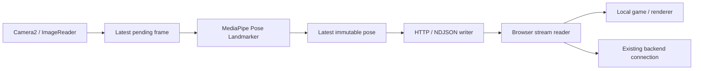

# Architecture

> Protocol version 2 supports game-selected one/two-player output with fixed-side
> player IDs and one persistent two-pose GPU task. See
> [implementation and validation](docs/two-player-capture.md). The GPU/libyuv
> performance baseline is accepted; extended benchmarks are deferred.

## Goal and current state

The Open-Q 624A captures frames and estimates poses locally with MediaPipe. A computer browser receives landmarks over a persistent LAN connection and can forward them through the game's existing backend connection. Local consumption must not wait for the backend.

The repo contains `androidApp` and `shared`. Camera2 capture, Lite GPU LIVE_STREAM inference, a bounded HTTP server, common protocol, and Start/Stop UI are implemented. A local HTTP test page renders poses; deployed HTTPS validation is deferred. See [live validation](docs/hardware/live-pose-validation.md) for short board measurements and remaining acceptance checks. Synthetic production remains a debug diagnostic.

The device runs Android Things on Android 8.1/API 27, with 32-bit ARM userspace and low-RAM configuration. [Hardware observations](docs/hardware/open-q-624a.md) make capture and native MediaPipe loading the first compatibility gates. Google's Android Things console was retired; deployment uses existing firmware and ADB without that service. See the [official sample's retirement notice](https://github.com/androidthings/sample-googleassistant).

## Data path



The browser initiates `GET /v1/stream`; Android pushes through that response. Keep the [streaming specification's](camera-to-client-streaming.md) HTTP port `1337`, NDJSON, and one streaming client initially. No per-frame requests or WAN relay sit between inference and the browser.

HTTP over TCP is the initial practical low-latency design, not a guarantee of the lowest possible latency under packet loss. Measure it before considering another transport.

## Source structure

```text
androidApp/src/main/
  AndroidManifest.xml
  assets/pose_landmarker_lite.task        # bundled offline model
  kotlin/tech/aerodance/androidclient/
    MainActivity.kt                      # existing entry point
    camera/                              # CameraSource, Camera2, conversion
    pose/                                # LivePoseEstimator, result mapping
    pipeline/                            # lifecycle, frame admission
    streaming/                           # HTTP routes, CORS, stream writer
shared/src/commonMain/kotlin/tech/aerodance/androidclient/
  App.kt                                 # status and Start/Stop UI
  protocol/                              # wire models, player assignment, config
  pipeline/                              # latest-frame mailbox, task timestamps
shared/src/commonTest/                    # protocol and bounded-state tests
androidApp/src/debug/                     # hardware diagnostic activities
scripts/release-camera.sh                 # ADB camera-owner utility
docs/hardware/open-q-624a.md               # observed deployment baseline
```

`androidApp` depends on `shared`. Common models use ordinary Kotlin values, never `Image`, `Bitmap`, `MPImage`, or MediaPipe results. A small composition root wires components together; a database and more application modules are unnecessary.

## Camera and inference

Use **Camera2** for this fixed board. Its HAL exposes Camera2 with vendor-specific behavior, so direct capture gives a clear baseline without adding CameraX dependencies. Keep a narrow `CameraSource` boundary for substituting CameraX later if it improves reliability.

Use `ImageReader` with `YUV_420_888`, initially 640×480 and the advertised `[30, 30]` FPS range. Start with ordinary automatic controls. Sensor metadata reports 90 degrees, but the user confirmed that this camera mounting should be processed **without rotation**. The live pipeline uses unmirrored 640×480 input. Anatomical left/right still needs visual validation.

Drain with `acquireLatestImage()` on a camera worker. Start with `maxImages = 3`, retaining at most one pending image and leaving headroom to discard older images. Convert using actual YUV row/pixel strides; copy into bounded inference-owned RGB storage, then close the camera image. See [ImageReader ownership rules](https://developer.android.com/reference/android/media/ImageReader#acquireLatestImage()).

JNI libyuv is the sole camera converter and writes directly into the
inference-owned bitmap at 0°. Capture snapshots use libyuv as well; see [conversion implementation and measurements](docs/libyuv-conversion.md).

Use MediaPipe Tasks Pose Landmarker with `RunningMode.LIVE_STREAM` and `detectAsync()`. Use Lite, a detection limit of two poses in both game modes, segmentation disabled, and default confidence thresholds. Package the model for offline operation. See the [Android task guide](https://ai.google.dev/edge/mediapipe/solutions/vision/pose_landmarker/android).

GPU is the sole delegate; CPU selection and its saved UI switch have been removed at the user’s request. Short board probes establish GPU callback delivery and faster mean inference, with slow initialization; real-person accuracy and sustained latency/stability still need comparison. Create, invoke, and close a GPU task on its required owning thread. Reported GLES support does not prove delegate compatibility.

Submit strictly increasing monotonic milliseconds and correlate callbacks by task timestamp. Explicit admission keeps one task in flight; errors and a bounded watchdog recover a stuck estimator. Do not assume every submitted frame generates a callback. See the [PoseLandmarker API](https://developers.google.com/edge/api/mediapipe/java/com/google/mediapipe/tasks/vision/poselandmarker/PoseLandmarker).

## Scheduling and backpressure

| Boundary | Policy |
|---|---|
| Camera → inference | One in-flight input plus one replaceable pending frame; close superseded images |
| Inference → protocol | Map to immutable values and publish immediately |
| Protocol → writer | One replaceable pending pose; serialize newest state when writable |
| Writer → TCP | Flush each record; bounded write deadline and cancellation |
| Browser → rendering | Update latest pose immediately; draw once per animation frame |
| Browser → backend | Separate bounded latest-state path |

An application queue cannot remove bytes buffered by HTTP/TCP. The server must support bounded output and cancellation of blocked writes. Close streams exceeding their write/age budget; reconnect with fresh state. Disable compression/batching initially and test `TCP_NODELAY` if available.

Sequence gaps are normal. Pose state needs no acknowledgment or replay. Game events derived from poses need separate delivery semantics.

## Lifecycle and UI

A `PipelineController` owns the camera, estimator, server, workers, and shutdown.
`LivePoseEstimator` delivers immutable common `InferenceResult` values without wire
sequence allocation. `PoseServer` serializes `PlayerOutput` publication and config
under one short lock: select players, allocate sequences, replace the snapshot and
notify the writer. Mode changes publish an empty snapshot, preserving the camera,
GPU task, session and open stream. No socket write or native inference holds that
lock. `MainActivity` preserves the selected count in process memory across activity
recreation; a fresh process defaults to one player. Start once, stop idempotently, and handle camera contention, model errors, Wi-Fi changes, and disconnects without leaks.

Initially run the server while the activity is active; stop on leaving that lifecycle and restart automatically on launch/return using the saved origin after initial setup. Manual Stop pauses streaming until Start or the next foreground entry. Camera capture and GPU inference start only after a browser opens `/v1/stream`. Disconnect detection stops capture, closes pending images, drains and closes the GPU task, then releases the camera reader and workers. Reconnect waits for that release before creating another camera/task pair; the server session, sequence counter and player count survive. Status/config requests do not start capture. A service and boot launch are a later milestone: verify this image's launcher/permissions, using an appropriate foreground service if continuous capture is required.

While idle, `pipelineState: running` means the server is ready to accept a stream.
Opening a live stream sets it to `starting`; heartbeats keep that stream alive
through GPU initialization. The first successful inference sets it to `running`
and publishes a pose, including an empty pose when nobody is detected. Config
snapshots are withheld during initialization so they cannot falsely signal
readiness. Disconnect restores server readiness for the next connection.
The browser shows `initializing` until its first accepted, matching pose and
allows 90 seconds after opening the stream; heartbeats do not extend that deadline.

Show Start/Stop, LAN address/port, errors, browser connection, capture/result rates, and timing summaries. Preview/skeleton rendering are optional diagnostics that can be disabled. Game credentials stay in the browser/backend.

The manifest declares `CAMERA`, `INTERNET`, and network-state access. Test camera permission behavior on this Things image. API 27 does not use the newer LAN runtime permission; deployments on Android 17 with target SDK 37 need `ACCESS_LOCAL_NETWORK` handling. See [Android LAN permission guidance](https://developer.android.com/privacy-and-security/local-network-permission).

## Timing and performance

Record camera callback arrival, conversion, submission, completion, and write start/end on one Android monotonic clock. Sensor timestamps measure intervals, but this board reports `timestampSource = UNKNOWN`; do not compare them directly to that clock.

Wire timing is labeled as arrival-based. Measure sensor-to-browser latency using an external visual test, or calibrate clock domains and quantify uncertainty. Browser `performance.now()` and Android uptime cannot be directly subtracted; clock calibration requires a separate measurement exchange.

Provisional goals: sustained 30 pose results/second where inference permits, p95 camera-callback-to-browser receipt <100 ms, and p95 inference-completion-to-write-completion <10 ms on a healthy LAN. These are unmeasured targets. Bounded age takes priority over an FPS number.

Extended stage profiling and 30-minute memory/thermal benchmarks are deferred. Short board measurements and their limits are recorded in [native conversion](docs/libyuv-conversion.md) and [player-mode validation](docs/two-player-capture.md). Heartbeats and pose freshness are separate metrics.
