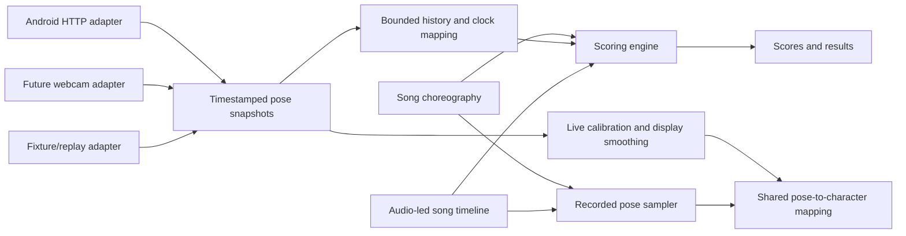

# Android client and dance game integration plan

Prepared 2026-10-10 from the current repository and the research linked below. This document proposes implementation work; it does not claim that integration or scoring is already implemented.

## Initial UI implementation status

The main app now keeps **Start**, opens One Player / Two Players, and then opens
Song Select. Connect Client uses the Android protocol v2 transport with cancellable
startup, player-mode boundaries, stale clearing, and bounded reconnects. Opening
a stream starts capture on demand; the game shows “Camera starting…” until its
first pose, allowing up to 90 seconds on every connection/reconnect. Startup
heartbeats keep the stream alive without marking tracking ready. Song Select
shows each player's detection status. **Webcam (dummy)** is an explicit menu-testing
option that bypasses Android pairing without camera capture or pose/scoring data. The published catalog is empty; the existing
silent recording is available as a preview. Audio/countdown, live character mapping,
scoring, and results are not implemented yet. Container checks cover the transport;
real-board and deployed HTTPS acceptance remain outstanding.

## Intended experience

1. The main screen has **Connect Client** in the bottom right. Clicking it reveals an IP input, initially **192.168.43.1**, and **Ok** / Cancel. Ok connects to the Android app on port **1337**. Remember a successfully used address for subsequent visits. Show connecting, connected, reconnecting, and actionable error states, plus Disconnect once connected.
2. Keep the current **Start** label. Start opens **One Player / Two Players**, then song selection. Both modes use the same song catalog. Single-player mode uses only choreography track 0 from the two-player song.
3. Choosing a song loads its audio and choreography, verifies input readiness, then displays **3, 2, 1** over three seconds. At zero, music and reference dancers start together. Readiness/loading happens before the countdown.
4. Show one or two large Frutiger reference characters in the central dance area, playing the recorded choreography. Show a smaller Frutiger character displaying player one's live pose in the top left; show player two's in the top right only in two-player mode. Label the live panels and show each player's score and tracking status.
5. Score each player against their corresponding reference track, accounting for input timing. End at the song's authored endpoint and show results, Retry, and Song Select.

Default decisions: one Android device captures both people; two-player participants stay in separate camera halves; gameplay requires a connected, usable pose source; the initial supported deployment is desktop Chrome. Real webcam capture is a later adapter; a dummy webcam option now permits menu testing without Android. The shared architecture must be designed now. These are implementation defaults, not additional requirements the user must resolve before work begins.

## What exists and what is missing

| Area | Current evidence | Required change |
| --- | --- | --- |
| Game flow | Start opens player selection, then Song Select with an empty published catalog. Webcam dummy bypasses device pairing for menu testing. | Real songs, audio, countdown, gameplay, and results. |
| Android connection | The game adapter consumes protocol v2 status/config/NDJSON with bounded startup, freshness, and reconnect handling. | Validate real-board pairing from deployed HTTPS and integrate the shared pose model. |
| Player slots | Android emits explicit `playerId: 0/1`; two-player IDs represent fixed camera halves. | Map IDs to player panels and tracks; never use pose-array position as identity. |
| Recorded characters | `temp/frutiger-character/client/src/Character.jsx` and `motion.js` animate the GLB from recorded `dance.json`. The main menu imports these assets. | Promote reusable code/assets out of `temp/`; add live pose support. |
| Live retargeting | **Not implemented.** `createRetargeter(model, data, person)` samples an entire recorded clip and derives calibration from that clip. | Split pose sampling, calibration, and pose application; implement an Android-to-shared-format adapter. |
| Recording | Locked Python/OpenCV/MediaPipe video tracking already produces two tracks, confidence, provenance, and review overlays. | Song alignment, Android landmark capture, persistent editing projects, timeline editor, and validated publishing. |
| Timing/scoring | Android emits monotonic callback/inference timestamps; no browser/device clock exchange or score engine exists. | Clock synchronization, residual capture-delay measurement, audio timeline mapping, scoring research and implementation. |

The recorded format is version 1: `times[]`, `poses[frame][person][landmark]`, with each landmark `[x,y,z,confidence]`. Android's wire protocol is version 2: a timestamped snapshot with `poses: [{playerId, landmarks: [{x,y,z,visibility,presence}]}]`. They share MediaPipe's 33-landmark ordering, but they are **not interchangeable formats**. The two version numbers identify different schemas.

Use [the Android streaming specification](../client-android/camera-to-client-streaming.md) as the existing wire contract and [the capture guide](../temp/frutiger-character/README.md) as the recorded-playback baseline.

## Shared architecture



Introduce a small `PoseSource` interface: `connect`, `disconnect`, `setPlayerCount`, capabilities/status, and subscriptions for complete pose snapshots and source errors. Keep transport details behind it. Provide Android and deterministic fixture adapters initially; implement webcam later without changing scoring or character rendering.

Use an internal pose snapshot containing source/session ID, sequence, player count, input dimensions/mirroring, source frame time, mapped browser frame time, receipt time, timing uncertainty, and poses keyed by player ID. Each pose has 33 landmarks with separate optional visibility/presence. Preserve relative depth as relative depth. Keep raw samples available for scoring; display smoothing must not alter scoring input.

Adapters convert wire/recorded representations at their boundaries. Existing recordings' combined confidence cannot recover separate visibility/presence; mark that provenance explicitly. Keep the choreography format independently versioned. Do not create a fake recorded clip for every incoming live pose.

Suggested production layout:

| Location | Responsibility |
| --- | --- |
| `client/src/pose/` | Internal types/validators, Android/fixture adapters, normalization, bounded history, calibration, clock mapping. |
| `client/src/character/` | Character asset loading/cloning, appearance, calibration, pose application. |
| `client/src/game/` | Session controller, audio timeline, choreography sampling, scoring, gameplay layout, results. |
| `client/src/menu/` | Main menu, player selection, song selection, connection controls. |
| `client/public/songs/` | Published song manifest, audio, versioned choreography. |
| `tools/choreography/` | Local recording, video import, editor, validation, publication commands. |

Run gameplay and scoring locally in the browser. The existing Socket.IO backend connection is separate from the Android connection and should not determine pose freshness. Aggregate result persistence can be added through Express; per-frame WAN/database forwarding is unnecessary for this scope.

## Connection and player selection

- Reuse/refactor the bounded decoder and validation from `client-android/pose-test-site/dist/protocol.js`, retaining meaningful existing tests. Wrap networking in a production adapter rather than importing the test page's DOM code.
- Validate the address, use fixed port 1337, request status, require protocol v2 and supported player counts, configure the current count, wait for a running pipeline, then open the stream. Preserve the existing cancellable startup allowance of up to 90 seconds.
- On player selection, POST `{ "playerCount": 1 }` or `{ "playerCount": 2 }` on the existing connection. Accept the change using `sessionId`, `effectiveFromSeq`, and each record's `playerCount`; old-mode records can arrive after the control response. Require a subsequent matching-mode snapshot before countdown. Reapply count after reconnect.
- Each snapshot replaces all player slots. Omitted players and empty snapshots clear immediately. Start with the existing 500 ms stale-pose threshold and 12-second transport timeout, measuring whether they suit the observed feed. Heartbeats never refresh poses. Bound NDJSON records to 16 KiB and bound incomplete records too.
- Keep latest state for rendering and a separate small ring buffer for scoring. A slow renderer or backend must not block stream consumption. Reset history/calibration as appropriate on source/session changes; never mix timelines across a device restart.
- Preserve bounded reconnect behavior: delay capped at 8 seconds, stop after five consecutive failed attempts, and require another click after initial permission/connection failure. Disconnect cancels fetches, readers, timers, and pending configuration work.
- Connection status must distinguish a reachable device, a running stream, and players actually detected. Show missing-player status per slot and a simple camera-half placement cue for two players.

Keep the visual controls inside the current letterboxed frame. A real HTML input overlay is appropriate for IP entry and keyboard accessibility; align it with the existing in-canvas menu and prevent overlapping hit handlers.

Android currently requires an exact allowed Origin configured on the device. Show the game's origin in connection help, including local-development and preview origins. Verify production HTTPS permissions, CORS, preflights, and site policy before declaring pairing complete. Chrome documents permission-gated HTTP access to private IP literals from secure pages; this does not establish support in every browser. [Chrome Local Network Access guidance](https://developer.chrome.com/blog/local-network-access).

## Live and recorded poses on Frutiger characters

The existing asset has seven bones: Root, Body, Head, ArmL, ArmR, FootL, FootR. Hands and feet are detached stylized parts. Existing playback maps hips to root movement, shoulders to torso lean/yaw, facial landmarks to head motion, wrists to hands, and ankles to feet. It is camera-space 2.5D, with damped relative depth and a floor clamp. It cannot display anatomical elbow/knee articulation without a new rig.

Refactor the current implementation into:

1. A recorded sampler that returns one pose at a requested time, independent of model rendering.
2. A calibration object supplying aspect ratio, torso scale, hip baseline, and estimated floor. Recorded tracks can calculate it offline; live input needs a brief rolling window of reliable torso/ankle samples. Do not derive scale from a single jittery frame or continually rescale during a move.
3. `applyPoseToCharacter(model, pose, calibration, options)`, which applies the existing bone mapping without knowing whether the pose came from Android, a video, or a webcam.
4. Independent character instances for every reference/live actor, with independent skeletons and calibration. Two-player gameplay has four actors: two references and two live panels.

For live poses, handle unreliable joints locally: briefly hold an individual joint with a visual confidence cue, then fade toward a neutral pose. Missing whole players clear their live panel rather than displaying an apparently current frozen pose. Reacquire calibration after sustained absence or source changes. Add conservative display-only smoothing and bounded interpolation; avoid long extrapolation at the board's actual output rate.

Define a single left/right convention. Keep anatomical landmark labels unchanged internally; mirror only through a documented transform that also swaps anatomical pairs when creating mirrored choreography targets. Default to a mirrored coach experience, with player 0/1 panel assignment unchanged. Camera-half labels must follow the chosen display convention. Never silently choose the best score of mirrored and unmirrored poses each frame.

Validate raised right/left hands, crossed arms, lateral steps, torso lean, crouch, foot lifts, and turning against live input and video overlays. Compare the same poses through both adapters. Keep calibration/scale fixed enough that hands and feet do not jump during motion.

Research conclusion: reuse the current stylized mapping first. A generic skeletal animation retargeter does not supply the missing landmark-to-bone mapping or live calibration. Three.js skeleton cloning supports independent actors, which the existing code already uses. Research a fuller rig/IK only if review shows the detached-hand/foot character cannot communicate the choreography adequately. MediaPipe exposes normalized image landmarks and world landmarks, but Android currently advertises `worldLandmarks: false`; version one must work from image landmarks. [MediaPipe Pose Landmarker overview](https://developers.google.com/edge/mediapipe/solutions/vision/pose_landmarker).

## Song clock, countdown, and fair latency handling

Use one audio-led timeline for music, reference sampling, and score windows. Resume Web Audio during a user gesture, preload/decode audio, and finish readiness before countdown. Schedule audio to start three seconds ahead and derive the displayed countdown from that scheduled start. Never advance the song by accumulating capped rendering deltas: the prototype's loop clock can drift from music during stalls.

Map browser monotonic time to the **audible** song position using audio output timestamps where supported; measure a fallback and its uncertainty. Web Audio provides output timestamp mapping for this purpose. Include device/output-route calibration where necessary. [Web Audio specification](https://www.w3.org/TR/webaudio/#dom-audiocontext-getoutputtimestamp).

### Required Android timing extension

The current callback timestamps permit device processing-duration measurement, but not clock mapping or proven sensor-exposure timing. Add a small bounded `GET /v1/time` exchange returning session ID and two timestamps on the **same monotonic clock used by pose records**: request-received `a1` and response-prepared `a2`. Advertise the capability in status, document CORS/methods, and test it. This can be an additive protocol-v2 capability; do not silently infer support from version 2 alone.

For browser send/receive times `b0/b3` in milliseconds:

```text
androidMinusBrowser = ((a1 - b0) + (a2 - b3)) / 2
networkRoundTrip = (b3 - b0) - (a2 - a1)
frameBrowserTime = frameReceivedTimeMs - androidMinusBrowser - captureDelayMs
referenceTime = audibleSongTimeAt(frameBrowserTime)
```

Take several exchanges, prefer low-round-trip samples, reject outliers, track uncertainty, and refresh periodically to estimate drift. HTTP measurements include scheduling/asymmetry uncertainty; half the measured round trip is an uncertainty estimate, not proof of symmetric network delay. Keep synchronization work bounded and separate from inference. Reset on Android session changes or browser clock/audio discontinuities.

`captureDelayMs` represents sensor exposure/readout/buffering before the camera callback. The board's sensor timestamp source is unknown. Measure this residual with an external visual timing test, or calibrate the sensor clock relationship before using it. Do not tune device latency by maximizing a player's dance score, because that would erase actual timing mistakes.

Score against frame time, not receipt time or `resultTimeMs`. Inference and network delays then affect when feedback appears, not which reference pose is compared. Record callback-to-result duration, mapped frame age, jitter, sync uncertainty, and capture calibration separately.

Use a bounded late-arrival allowance before finalizing score windows; an initial candidate is 750 ms with a two-second history, to be revised from measured latency tails. This deadline is distinct from player timing tolerance. Reject samples beyond the deadline, count each score interval once, and report excessive drops as degraded input. Pause/recalibrate on transport failure, session reset, or unusable clock mapping. A device lacking the timing capability may offer an explicitly uncalibrated preview, but cannot satisfy fair scored gameplay acceptance.

Pause audio and reference time together when the game is paused or the tab becomes hidden. Clear pending old samples, recheck input/clock readiness, then resume with a countdown at the preserved song position. Wait for the bounded final input allowance before publishing final results.

## Scoring research and proposed baseline

Research should produce a reproducible comparison and a short scoring decision document before thresholds are frozen. Google describes torso-size normalization and joint-distance features for pose comparison; that legacy classification example informs feature design but is not a dance score specification. A Stanford dance-coaching project demonstrates DTW sequence alignment; its ballet dataset and score scaling do not establish suitable thresholds for this game. [Google pose classification guidance](https://raw.githubusercontent.com/google-ai-edge/mediapipe/master/docs/solutions/pose_classification.md), [Stanford dance-coaching study](https://cs231n.stanford.edu/papers/CS_231N_Final_Project__Latex_Writeup_Update%20-%20Henry%20Jingsong%20Zhou.pdf).

Compare these candidates:

| Method | Benefit | Concern / intended role |
| --- | --- | --- |
| Normalized landmark and limb-direction distance | Cheap, interpretable, preserves pose geometry. | Viewpoint and confidence sensitivity; baseline candidate. |
| Joint angles plus limb directions | Less dependent on limb length; directions distinguish raised/lowered limbs with equal bend angles. | 2D projection and occlusion still matter; compare as a hybrid. |
| Constrained short-window DTW | Can compare an entire move despite small timing variations. | Excessive time warping can reward dancing off beat; evaluate with a strict band and a timing penalty. |

Proposed initial score pipeline:

- Correct image aspect ratio, center on the hips, and use a stable calibrated torso scale. Avoid dynamic rotation normalization that would remove intentional torso lean. Use consistent frontal recording/play conditions; 2D features cannot guarantee viewpoint invariance.
- Compare shoulders, elbows, wrists, hips, knees, ankles, and limb directions. Downweight face/finger landmarks initially. Use reference and live confidence to select usable features; require a minimum torso and limb coverage.
- Include pose shape and movement direction/change over time so holding one easy pose does not earn a high score through a moving phrase. Avoid making root screen position a core metric because camera placement differs; retain a separate normalized lateral-movement feature if validation supports it.
- Start with timestamp-aligned comparison and a small bounded timing tolerance, provisionally ±100 ms, with a penalty for temporal displacement. Compare with constrained DTW during research. Network latency correction and player timing tolerance are separate controls.
- Produce one score per fixed authored time interval, provisionally 100 ms, rather than per render frame or received packet. Interpolate only between nearby reliable samples; do not bridge long missing spans. This makes totals independent of FPS and duplicate packets.
- Weight each player's total by authored interval duration/importance, then map a versioned normalized error curve to points and feedback such as Perfect/Good/Miss. Research selects feature weights, curve, confidence threshold, timing tolerance, and feedback thresholds; the provisional values are not validated results.
- Compute player 0 against track 0 and player 1 against track 1. Keep their scores independent. One-player mode must produce the same track-0 result as two-player mode for identical input.

Authoring marks unreliable reference intervals unscorable before publication. Missing/unreliable live tracking gives **no awarded points** for that interval and is displayed as tracking loss rather than a confident dance judgment. Keep the published possible-point denominator fixed; never inflate accuracy by removing a player's difficult missing intervals. Report tracking coverage separately. Extended source failure pauses the session; sessions with inadequate coverage are incomplete and cannot be presented as comparable ranked results. Choose the minimum completion coverage during validation.

Build a small evaluation set containing good attempts, wrong limbs, mirrored mistakes, off-beat attempts, held poses, different body sizes/distances, occlusions, different outfits/lighting, two players, and recorded input with injected latency/jitter. Obtain human judgments and tune on a separate subset from final evaluation. Compare live Lite output with offline Full-model references: different model quality is a measurable domain difference, not an assumption that the scores are equivalent.

Acceptance evidence must show that better matching attempts score higher, timing mistakes remain distinguishable after latency compensation, a static pose does not defeat a moving routine, and equivalent timestamped inputs score the same under tested delivery delays within the late-arrival allowance.

## Two-player recording and editing workflow

The [song and dance authoring reference](song-dance-authoring-workflow.md) specifies
the Docker-hosted editor, project persistence, timing/edit semantics, and runtime
bundle contract. New recordings and compiled choreography use Android-shaped pose
objects with separate visibility/presence; the demo tuple format requires migration.

Deliver both a local authoring workflow and usable tools, rather than requiring hand edits to landmark JSON.

1. **Create a song project.** Set stable song ID, title/artist, audio, duration, dance interval, choreography version, mirror convention, and two persistent track IDs. The project owns audio alignment and reference calibration.
2. **Record a two-player take.** A local recorder plays the song with a lead-in, configures Android for two players, and saves every received landmark snapshot with original timestamps, mode/session, timing calibration, confidence, and source metadata. Reuse the input adapter. Abort or mark a take invalid on device/session discontinuities. Keep dancers in separate camera halves because Android IDs change when people cross the center.
3. **Support video import.** Promote the existing locked Python tracker and diagnostics into the tools area, with compatibility for the current demo. A full-body fixed-camera two-player video supports more precise offline review and richer sampling. Recording video is a local authoring action; it does not require adding video streaming to the Android app.
4. **Align to song audio.** Preserve video presentation timestamps and specify `poseTime -> songTime` offset, with an optional drift correction for independently recorded audio/video. Use a sync cue or reference audio to establish alignment; review near the beginning and end. An Android take uses the recorder's calibrated audio timeline. Do not assume sample index divided by FPS is the song time.
5. **Edit in a local timeline tool.** Show waveform/time ruler, optional source video/skeleton overlay, confidence/gap markers, and both Frutiger previews on the same clock. Support scrubbing, playback, trim, offset, split, replacement of selected sections from another take, track reassignment/swap, joint or keyframe corrections, bounded gap repair, smoothing settings, and explicit unscorable intervals. Keep segment replacement aligned to song time. Support undo/redo and save/reopen.
6. **Export and validate.** Compile edits into timestamped two-track choreography plus per-track calibration, confidence/quality masks, source provenance, edit history/version, and a song manifest. Validate finite values, ordering, IDs, time coverage, audio alignment, gaps, references, and scoring metadata. Block publication on unresolved identity swaps or long unreviewed gaps.
7. **Review in the actual game.** Preview at normal speed, check sync, difficult poses, and both tracks. Publish the compiled assets to the song catalog; keep raw takes/videos and editing projects outside public assets. Keep export reproducible from source and edit decisions.

Store edits non-destructively: raw take + project/operations + compiled runtime output. The runtime needs only audio, manifest, and compiled choreography. A single song contains both tracks; one-player playback/scoring selects track 0 without regenerating a separate song. If track 1 fails quality review, block the two-player release until repaired.

Existing offline smoothing is symmetric and can use future frames. Live display cannot use that method without delay. Preserve raw confidence and distinguish repaired joints from measured ones in the editor and score reference masks. Do not use the demo's looping seam crossfade in finite-song gameplay; stop at the authored endpoint.

## Implementation sequence and completion gates

| Stage | Concrete deliverable | Gate before moving on |
| --- | --- | --- |
| 1. Contracts and fixtures | Shared pose model, choreography/song schemas, fixture adapter, module boundaries, scoring evaluation plan. | Existing recorded clip and Android snapshots convert correctly without losing IDs/timing/confidence; gaps remain explicit. |
| 2. Pairing and player flow | Bottom-right Connect Client/IP/Ok, adapter lifecycle, One/Two Players then song selection. | Real Android connection from deployed HTTPS; configuration boundary and reconnect handling pass; actionable permission/origin errors. |
| 3. Character integration | Extract pose application/calibration from clip sampling; render live panels and reference actors. | Live Android poses drive independent Frutiger characters; left/right, stale clearing, calibration, and transforms pass visual review. |
| 4. Clock and playback | Android timing capability, synchronization, audio timeline, loading, three-second countdown, finite-song playback. | Measured mapping/residual-delay uncertainty; audio/reference alignment survives stalls, pause, and resume. |
| 5. Recording tools | Android take recorder, promoted video importer, song project schema, timeline editor and compiled export. | Record/import, edit, save/reopen, export, and play a real two-player routine; single-player uses its track 0. |
| 6. Scoring | Research comparison, documented decision, versioned implementation, player feedback/results. | Held-out human comparison and injected-delay tests demonstrate useful, fair behavior and sensible tracking-loss handling. |
| 7. Integrated acceptance | Full playable song, production browser/device tests, authoring guide. | All requirements below pass, with remaining device/browser limitations documented. |

Stages 3 and 4 can use the fixture source while device integration develops; stage 5 may begin once schemas stabilize. Score feature research starts in stage 1, but final calibration depends on actual live input and authored routines. No broad Android pipeline rewrite is required: preserve GPU/libyuv, bounded queues, two-pose task, and existing player selection.

## Verification and definition of done

- **User flow:** Connect Client opens the correctly prefilled field; Ok connects; Start asks player count; choosing it proceeds to songs; an authored song runs after exactly three scheduled countdown seconds; Retry and Song Select work without leaking streams/audio.
- **Rendering:** One/two reference characters follow the song; player one appears top left and player two top right only when selected; live movement is independent; missing/empty/stale input clears; no anatomy/mirror mixups or non-finite transforms.
- **Protocol:** Test chunk boundaries, oversized/incomplete records, sessions/sequences, config races, right-only ID 1, omitted slots, cancellation, busy stream slot, and bounded retries. Keep diagnostics distinct from actual dance accuracy.
- **Timing/scoring:** Replay known samples through different FPS, duplicated packets, device-clock offsets/drift, delivery delay/jitter, short gaps, and late arrivals. Compare within a defined score tolerance. Deliberately early/late dancing must still change timing scores. Verify deterministic track-0 equivalence across player modes.
- **Audio:** Verify countdown/autoplay handling, audible alignment near song start/end, pause/hidden-tab resume, output-device changes, and final late-arrival handling. Reference playback never loops automatically.
- **Authoring:** Produce a two-player song from a new take/video, fix a section/identity issue, save/reopen, re-export reproducibly, and verify both modes in the game. Confirm quality masks exclude interpolated unreliable reference spans.
- **Extensibility:** Run the same rendering/scoring pipeline using the fixture adapter without Android-specific branches. Document webcam timestamp and assignment expectations. Future browser inference belongs in a worker because MediaPipe's web detection calls block the main thread. [MediaPipe Web guide](https://developers.google.com/edge/mediapipe/solutions/vision/pose_landmarker/web_js).
- **Checks:** Run relevant Node protocol/scoring/retargeting tests, the existing character/tracker checks when touched, and the root build. Android timing changes require `./gradlew :shared:testAndroidHostTest :androidApp:assembleDebug`, then real-board verification. Add browser interaction coverage for the complete flow and production HTTPS/manual permission checks.

The short Android observation recorded about 9.1 pose results/second and 126 ms mean callback-to-result processing time, with a maximum receipt gap about 505 ms. These are observations from a scene-dependent short run, not sensor-to-browser latency, sustained performance, or proof of two-person accuracy. Design interpolation/scoring around irregular samples, and validate an entire song with two actual people before accepting the game. See [Android player-mode validation](../client-android/docs/two-player-capture.md).

Completion means a real, authored two-player song is recordable/editable and playable from the deployed game using Android, with calibrated timing, independent scores, correct live/reference characters, and single-player playback derived from the same track-0 choreography. Planning or synthetic playback alone does not meet that gate.
